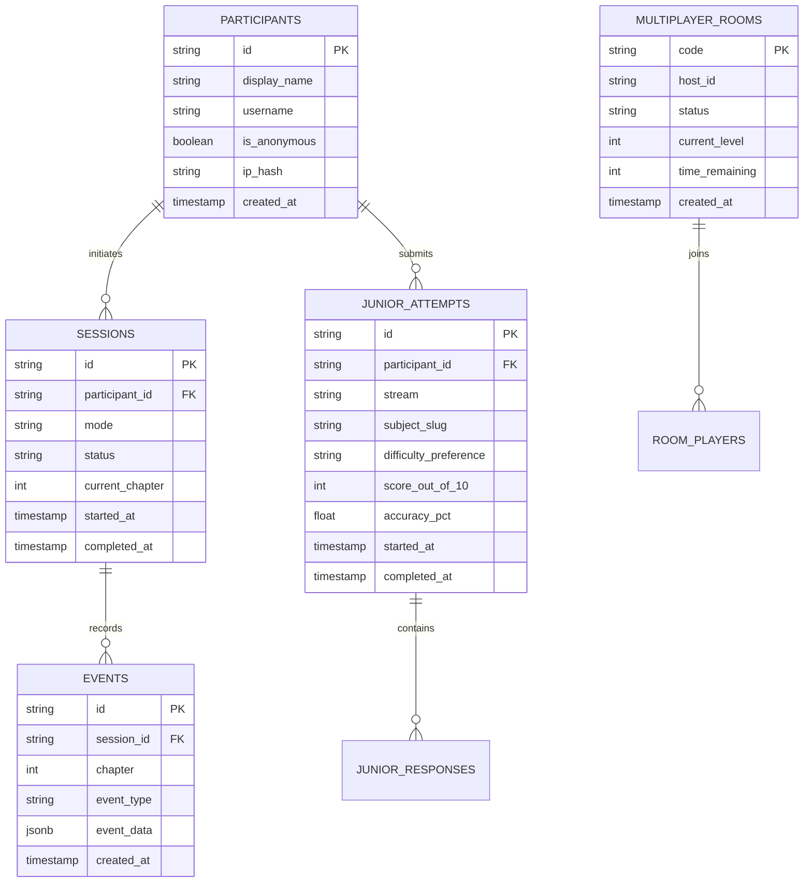

# THE UNWRITTEN — Database & State Schema Specification

## 1. Storage Topology
THE UNWRITTEN employs a hybrid architecture:
- **Primary / Edge Persistence**: Vercel Postgres / Neon SQL Database (when `POSTGRES_URL` is configured).
- **Graceful Zero-Config Fallback**: File-based / Memory store (`PlatformStore`) preserving session integrity, telemetry events, and progress even in local or isolated deployment environments.

## 2. Relational Schema Architecture

## 3. Privacy & Data Governance
- Strict participant consent enforcement before storing names or usernames.
- IP addresses are salted and hashed (SHA-256) for audit trails and abuse mitigation without storing PII.
- Comprehensive GDPR/CCPA participant deletion endpoints supported in `/api/v1/admin/participants/[id]`.

