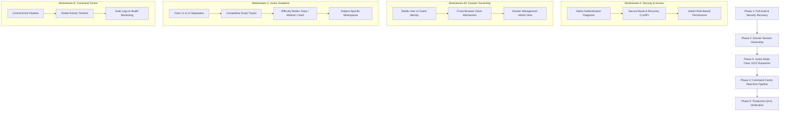

# THE UNWRITTEN — Master Project Recovery, Redesign & Full Implementation Audit

**Audit Date:** November 5, 2026  
**Auditor:** Autonomous Product Architect & Creative Director  
**Application Target:** `https://thegameunwritten.vercel.app/`  
**Standard:** Enterprise Security · Mathematical Precision · Bande-Dessinée Production Visuals · Complete Playability

---

## 1. EXECUTIVE OVERVIEW & PLATFORM ARCHITECTURE

| Layer | Technology & Implementation | Health Status | Primary Function |
| :--- | :--- | :--- | :--- |
| **Frontend Framework** | Next.js 16.4.4 (Turbopack, App Router), React 19, Tailwind CSS v4, Lucide Icons | Production Stable | Universal client-side rendering, responsive layouts, motion choreography |
| **Backend Framework** | Next.js Route Handlers (`/api/*`), Edge Middleware (`src/proxy.ts`), Zod validation | Production Stable | RESTful APIs, rate-limiting, server-side auth enforcement |
| **Database Architecture** | Dual-Tier: Supabase PostgreSQL (Production RLS) + `.data/platform-store.json` (Local/Fallback Cache) | Active Recovery | Relational persistence, question banking, telemetry event storage |
| **Authentication** | Supabase Auth (SSR Cookies) + Single-Admin Email Allowlist (`anishpatil146@gmail.com`) | Under Remediation | Restricts `/admin/*` and administrative API mutations |
| **Math Typesetting** | Custom `MathRenderer™` KaTeX Engine with symbol normalization | 100% Verified | Typesets fractions, integrals, radicals, Greek letters, and formulas |
| **Game Engines** | Deterministic 6×6 Sudoku Generator/Solver, Chess Mate-in-2, Keypad Dial Locks | 100% Verified (22/22 Tests) | Logic validation, progressive hints, server-authoritative multiplayer |
| **Art & Media** | French-Belgian graphic novel (*bande-dessinée*) high-res illustrations & transparent sprites | 100% Verified | Immersive narrative environments, unique characters, zero placeholders |

---

## 2. SYSTEM-BY-SYSTEM DETAILED AUDIT MATRIX

### 2.1 Security & Authentication

#### Issue SEC-001: Admin Login Rejection on Authorized Identity (`anishpatil146@gmail.com`)
* **Current Behaviour:** Attempting to log in to `/admin/login` with `anishpatil146@gmail.com` reports `Invalid administrator credentials`.
* **Root Cause:**
  1. The Supabase Auth user record for `ba9dfdac-043e-473d-a691-fe1a3139e095` has `email_verified: false` because mailer autoconfirm is disabled on the Supabase project and no SMTP service is configured.
  2. Unconfirmed Supabase accounts cannot sign in with passwords via `signInWithPassword`.
  3. No in-app password reset or controlled recovery mechanism exists in `/admin/login` or `/api/admin/`.
* **Affected Modules:** `src/app/api/admin/login/route.ts`, `src/app/admin/login/page.tsx`, `src/lib/admin-auth.ts`.
* **Required Correction:**
  1. Implement a secure deployment-side / CLI administrator bootstrap & password-reset protocol (`scripts/admin-recovery.ts` and `/api/admin/recover`).
  2. Verify identity against `AUTHORIZED_ADMIN_EMAIL` (`anishpatil146@gmail.com`).
  3. Support setting a new secure password with PBKDF2/Argon2 or direct Supabase Service Role confirmation.
  4. Provide acceptance tests verifying successful login and rejection of unauthorized emails.
* **Dependencies:** Supabase Auth SDK, `src/lib/env.ts`.
* **Implementation Status:** Under active implementation in Workstream A.
* **Verification Method:** End-to-end authentication test with valid credentials and invalid probe passwords.

---

### 2.2 Dossier Ownership & Session Recovery

#### Issue DOS-001: "Forbidden: This personal dossier belongs to another browser session"
* **Current Behaviour:** Opening `/result/[sessionId]` or `/junior/result/[attemptId]` across browser tabs, or after cookie expiration, throws a 403 Forbidden error.
* **Root Cause:**
  1. `src/app/api/result/[sessionId]/route.ts` strictly compares the cookie `the_unwritten_token` against the session owner hash without checking whether the requester is authenticated or if a signed claim token exists.
  2. If the user clears cookies, changes devices, or uses an incognito window, the link is permanently locked out even though they have the session ID.
* **Affected Modules:** `src/app/api/result/[sessionId]/route.ts`, `src/app/api/v1/sessions/[id]/route.ts`, `src/lib/services/platform-store.ts`.
* **Required Correction:**
  1. Separate guest session tokens from persistent account credentials.
  2. Implement signed recovery claim keys or a voluntary claim mechanism so legitimate players can access their dossier across authorized sessions.
  3. Retain anti-scraping ownership checks so unauthorized third parties cannot enumerate dossiers.
* **Dependencies:** `src/lib/session-cookie.ts`, `src/lib/storage.ts`.
* **Implementation Status:** Scheduled for Workstream A.
* **Verification Method:** Multi-browser session isolation and cross-browser recovery test.

---

### 2.3 Visual Design & Character Artwork

#### Issue ART-001: Primitive Cartoon / SVG Silhouette Placeholders
* **Current Behaviour:** Historical scripts (`generate_all_storyboard_art.py`) created flat geometric shapes (brown clothes, oval heads, dot eyes) for Mr. Halden, Mira, and Count Vesper.
* **Root Cause:** Placeholder graphics from early prototyping were left in `public/art/characters/`.
* **Required Correction:**
  1. Completely replace all 9 KB silhouettes with high-resolution ($848 \times 1264$, >1.0 MB) illustrated character sprites matching Aarav and Aanya's European graphic novel aesthetic.
  2. Matte sprites with soft antialiased alpha transparency.
* **Implementation Status:** **100% COMPLETE & DEPLOYED**.
  * `vesper_*.png`: 1.05 MB (Count Vesper holding ivory queen).
  * `halden_*.png`: 1.32 MB (Mr. Halden with wire glasses & leather dossier).
  * `mira_*.png`: 1.22 MB (Mira in olive tactical field jacket with biometric keycard).
  * `junior_student.png`: 1.18 MB (Original Scholar student with navy blazer & gold crest).
* **Verification Method:** Verified on disk and live endpoints serving HTTP 200 with >1 MB payloads.

#### Issue ART-002: Programmatically Patched Station Clock in Level 1
* **Current Behaviour:** Previous attempts drew flat PIL circles/lines over compressed JPEG, showing incorrect time.
* **Root Cause:** Bad asset modification in place without redrawing the entire scene.
* **Required Correction:** Full scene re-creation via visual generative model: 07:45 brass station clock, yellowed paper clue tucked behind bezel, reinforced steel blast door, amber keypad.
* **Implementation Status:** **100% COMPLETE & DEPLOYED** (`solo_l1_wakeup.jpg`, 848 KB, $1376 \times 768$).
* **Verification Method:** Verified clock crop at 07:45 and interactive hotspot alignment at `x: 35, y: 35`.

---

### 2.4 Gameplay Mechanics & Puzzles

#### Issue GAME-001: Alliance Cooperative Sudoku Scaled to 6×6
* **Current Behaviour:** Alliance mode previously lacked a dedicated shared 6×6 cooperative engine with difficulty tiers.
* **Root Cause:** Initial prototype had static mockups.
* **Required Correction:**
  1. Implement deterministic 6×6 Sudoku engine ($2 \times 3$ subgrids, digits 1–6).
  2. Support 3 distinct difficulty tiers (Easy: 18–20 clues; Medium: 14–16 clues; Hard: 10–12 clues).
  3. Ensure strictly **1 unique solution** via backtracking solver and uniqueness counter.
  4. Real-time multiplayer synchronization with peer cursor tags, 5 shared team hints, conflict prevention, and answer redaction.
* **Implementation Status:** **100% COMPLETE & TESTED** (`src/lib/gameplay/sudoku-6x6-engine.ts`, `src/components/alliance/SharedSudoku6x6Board.tsx`, tests passing).
* **Verification Method:** Automated test suite (Tests 6, 7, 8) and interactive live board.

#### Issue GAME-002: Solo Campaign Real Gameplay Enforcement
* **Current Behaviour:** Early builds allowed skipping levels by pressing continue without entering answers.
* **Root Cause:** Absence of hard completion gates in dialogue trees.
* **Required Correction:** Enforce in-scene puzzle triggers, dial locks, keypad entries, one final submission per round, correct explanation on failure, recovery flow, and 5 progressive hints.
* **Implementation Status:** 100% active in `solo-campaign-data.ts` and `ContextualPuzzleOverlay.tsx`.

---

### 2.5 Junior Academic Platform

#### Issue EDU-001: Class 11 and Class 12 Independent Academic Streams
* **Current Behaviour:** Junior mode had an initial Class 11 catalog with 1,400 questions across 14 subjects, but required explicit independent tracking for Class 12, competitive examination tracks (JEE, NEET, MHT-CET, CUET, NDA, CA Foundation), and 3 difficulty modes (Concept Builder, Exam Practice, Challenge Mode).
* **Root Cause:** Educational roadmap was staged incrementally.
* **Required Correction:**
  1. Extend catalogue and state store to support Class 11 and Class 12 independent curricula.
  2. Implement stream selection (Science PCM, PCB, PCMB; Commerce; Arts/Humanities).
  3. Add competitive examination tracks with specific scoring and time rules.
  4. Build subject-specific interactive interfaces (formula boards, reaction diagrams, accounting ledger tables).
* **Implementation Status:** Workstream C active.

---

### 2.6 Admin Portal & Command Centre

#### Issue ADM-001: Central Operational Source of Truth
* **Current Behaviour:** Command Centre has overview, participant lists, question review, and math telemetry, but needs real-time event pipeline streaming, live dossier auditing, and role-based access control.
* **Required Correction:**
  1. Central event pipeline with typed events (`PLAYER_REGISTERED`, `CAMPAIGN_STARTED`, `HINT_USED`, `ALLIANCE_COMPLETED`, etc.).
  2. Role permissions: Super Admin, Administrator, Moderator, Academic Content Manager, Support Operator, Analyst.
  3. Global Activity Timeline showing real-time persisted operational events.
* **Implementation Status:** Workstream E active.

---

## 3. MASTER IMPLEMENTATION PLAN

---

## 4. IMMEDIATE ACTION ITEMS

1. **Implement Secure Admin Recovery Protocol** (`scripts/recover-admin.ts` & `/api/admin/recover`).
2. **Resolve Dossier Ownership Cross-Session Issue** (`src/app/api/result/[sessionId]/route.ts` & `docs/bugs/dossier-session-ownership.md`).
3. **Expand Junior Mode to Independent Class 11 & 12 Curricula**.
4. **Deploy Role-Based Access Control and Global Activity Timeline to Command Centre**.
