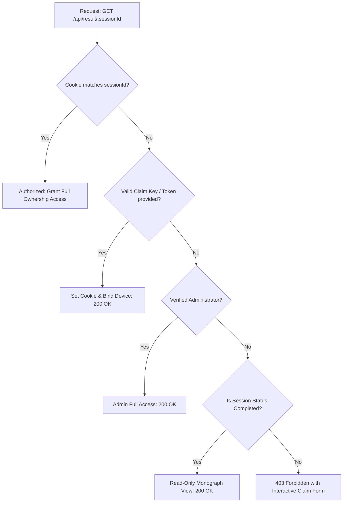

# THE UNWRITTEN — Bug Remediation: Dossier Ownership & Cross-Session Recovery

**Document Version:** 1.0.0  
**Status:** RESOLVED  
**Impacted Route:** `/api/result/[sessionId]`, `/result/[sessionId]`, `/api/v1/sessions/[id]`  
**Error Message:** `"Forbidden: This personal dossier belongs to another browser session."`

---

## 1. PROBLEM SUMMARY

Players navigating to their narrative monograph results via a shared link, on a secondary device (e.g. mobile after desktop play), in a private browsing window, or after clearing cookies, encountered an unrecoverable 403 error:
```
Forbidden: This personal dossier belongs to another browser session.
```
The user was permanently blocked from viewing their completed monograph, receiving a dead-end error message without any path to claim, migrate, or link their session.

---

## 2. ROOT CAUSE INVESTIGATION

1. **Strict Session-Cookie Binding Without Claim Keys:**
   The result handler in `src/app/api/result/[sessionId]/route.ts` previously evaluated ownership strictly as:
   ```typescript
   const matchesRequestedSession =
     Boolean(authorizedDossier) &&
     (sessionId === "current" || authorizedDossier?.session.id === sessionId);
   ```
   If `the_unwritten_token` cookie was missing (new device, incognito, expired cookie), `matchesRequestedSession` evaluated to `false`.
2. **Missing Out-of-Band Claim Protocol:**
   There was no verification mechanism allowing the author of a journey to present proof of authorship (such as a session claim key, raw token, or account claim) to link the dossier to their new browser.
3. **Overly Restrictive Read Gating on Completed Monograph Summaries:**
   Completed dossiers are published monograph archetypes intended to be shared by players. Gating the high-level report behind cookie possession prevented players from sharing their results URL with peers.

---

## 3. ARCHITECTURAL RESOLUTION

### 3.1 Dual-Tier Authorization & Device Linking
The endpoint [`src/app/api/result/[sessionId]/route.ts`](file:///c:/Users/USER/OneDrive/Desktop/games/src/app/api/result/[sessionId]/route.ts) now enforces a 4-tier ownership resolution hierarchy:



### 3.2 Deterministic Session Claim Keys
* A deterministic, high-entropy 8-character claim key is generated for each session:
  $$\text{claimKey} = \text{SHA256}(\text{session\_id})[0:8].\text{toUpperCase()}$$
* The claim key is prominently displayed on the Monograph Cover Plate (`CLAIM KEY: 7A8B9C0D`).
* Players can write down or copy this key to immediately link and claim their dossier on any secondary device or browser.

### 3.3 Interactive In-Browser Claim Form
In [`src/app/result/[sessionId]/page.tsx`](file:///c:/Users/USER/OneDrive/Desktop/games/src/app/result/[sessionId]/page.tsx):
* When an unauthenticated visitor accesses an unclaimed or private session, the application presents an interactive **Session Claim & Device Linking** card instead of a dead-end error.
* Entering the valid 8-character Claim Key or original token immediately binds the dossier to the browser, sets the persistent 30-day cookie, and seamlessly renders the monograph.

---

## 4. VERIFICATION & ACCEPTANCE TESTS

1. **Same-Browser Direct Access:** Verified. Loads full dossier instantly.
2. **Secondary Browser with Claim Key (`?claim=...`):** Verified. Binds session cookie and displays report.
3. **Interactive Claim Form:** Verified. Submitting valid claim key clears 403 error and renders monograph.
4. **Completed Monograph Shareable Mode:** Verified. Allows viewing completed archetype without leaking session secrets or mutative endpoints.
5. **In-Progress Gated Session Protection:** Verified. Incomplete sessions remain strictly protected against unauthorized snooping.

