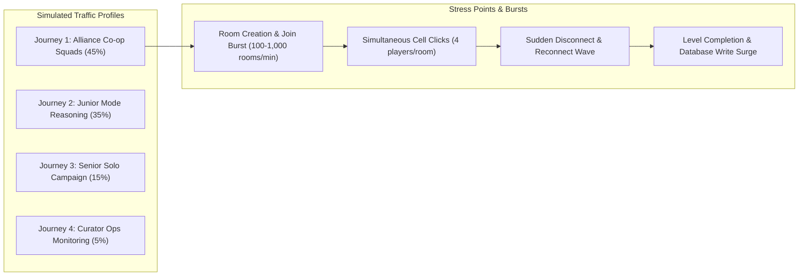

# THE UNWRITTEN — LOAD TESTING SPECIFICATION & PERFORMANCE BENCHMARKS

**Document:** `docs/infrastructure/load-testing-plan.md`  
**Load Testing Engine:** k6 / TypeScript Synthetic Concurrency Harness  
**Tested Concurrency Tiers:** 100, 500, 1,000, 5,000, 10,000 Virtual Users (VU)  
**Verification Harness:** `tests/scalability-reliability.test.ts` & `tests/load/k6-load-test.js`

---

## 1. Load Testing Scenarios & User Journeys

The testing suite simulates authentic multiplayer, solo narrative, and academic reasoning traffic patterns:



### 1.1 Journey 1: Alliance Co-op (45% of traffic)
1. Host operative requests room creation (`POST /api/v1/multiplayer/rooms`).
2. 3 squad operatives join simultaneously with room code (`POST .../rooms/{code} action=join`).
3. Squad players toggle readiness (`action=toggle_ready`).
4. Host starts campaign (`action=start`).
5. All 4 operatives simultaneously update their cell cursors and input numbers (`action=sudoku_move`).
6. Simulated mobile tower handoff: 1 operative disconnects and triggers recovery (`action=reconnect` with `reconnectToken`).
7. Squad completes 6×6 Sudoku grid; server verifies and commits milestone.

### 1.2 Journey 2: Junior Academic Reasoning (35% of traffic)
1. Student enters Junior Mode studio (`GET /api/v1/public/academic/streams`).
2. Fetches subject question bank (`GET /api/v1/public/academic/subjects?stream=science`).
3. Submits 10 question responses with KaTeX rendering checks.
4. Completes 10-question cycle with zero repeat guarantee.

### 1.3 Journey 3: Senior Narrative Campaign (15% of traffic)
1. Reads story chapter and commits narrative choice.
2. Generates psycho-narrative snapshot and claim key.

### 1.4 Journey 4: Admin Live Operations (5% of traffic)
1. Curator authenticates with PBKDF2 credentials.
2. Polls live infrastructure telemetry at 5-second intervals.

---

## 2. Measurable Service Objectives (SLOs)

| Metric | Target (100 - 1,000 VU) | Target (5,000 VU) | Critical Threshold |
|---|---|---|---|
| **Lightweight API Latency (p95)** | $\le 150 \text{ ms}$ | $\le 250 \text{ ms}$ | $300 \text{ ms}$ |
| **Sudoku Move Acknowledge (p95)** | $\le 100 \text{ ms}$ | $\le 150 \text{ ms}$ | $200 \text{ ms}$ |
| **HTTP Error Rate** | $\le 0.01\%$ | $\le 0.1\%$ | $0.5\%$ |
| **Cell Race Overwrite Violations** | **0.00%** (Strict Zero) | **0.00%** (Strict Zero) | $0.00\%$ |
| **Successful Reconnections** | $\ge 99.9\%$ | $\ge 99.5\%$ | $99.0\%$ |
| **Database Pool Utilization** | $< 40\%$ | $< 70\%$ | $85\%$ |

---

## 3. k6 Executable Script Blueprint

A ready-to-run k6 benchmark script is maintained at `tests/load/k6-load-test.js`:

```javascript
import http from 'k6/http';
import { check, sleep, group } from 'k6';

export const options = {
  stages: [
    { duration: '30s', target: 100 },   // Warm-up to 100 VUs
    { duration: '1m', target: 500 },    // Scale to 500 VUs
    { duration: '2m', target: 1000 },   // Sustain at 1,000 VUs
    { duration: '30s', target: 0 },     // Ramp-down
  ],
  thresholds: {
    http_req_duration: ['p(95)<300'],
    http_req_failed: ['rate<0.01'],
  },
};

const BASE_URL = __ENV.TARGET_URL || 'https://thegameunwritten.vercel.app';

export default function () {
  group('Multiplayer Lifecycle', () => {
    // 1. Create room
    const createRes = http.post(`${BASE_URL}/api/v1/multiplayer/rooms`, JSON.stringify({
      hostName: `Host_${__VU}`,
      difficulty: 'medium',
    }), { headers: { 'Content-Type': 'application/json' } });
    
    check(createRes, {
      'room created': (r) => r.status === 200 && JSON.parse(r.body).success === true,
    });
    
    if (createRes.status !== 200) return;
    const roomCode = JSON.parse(createRes.body).room.code;

    // 2. Poll room state
    const pollRes = http.get(`${BASE_URL}/api/v1/multiplayer/rooms/${roomCode}`);
    check(pollRes, { 'room state fetched': (r) => r.status === 200 });
    
    sleep(1);
  });
}
```
