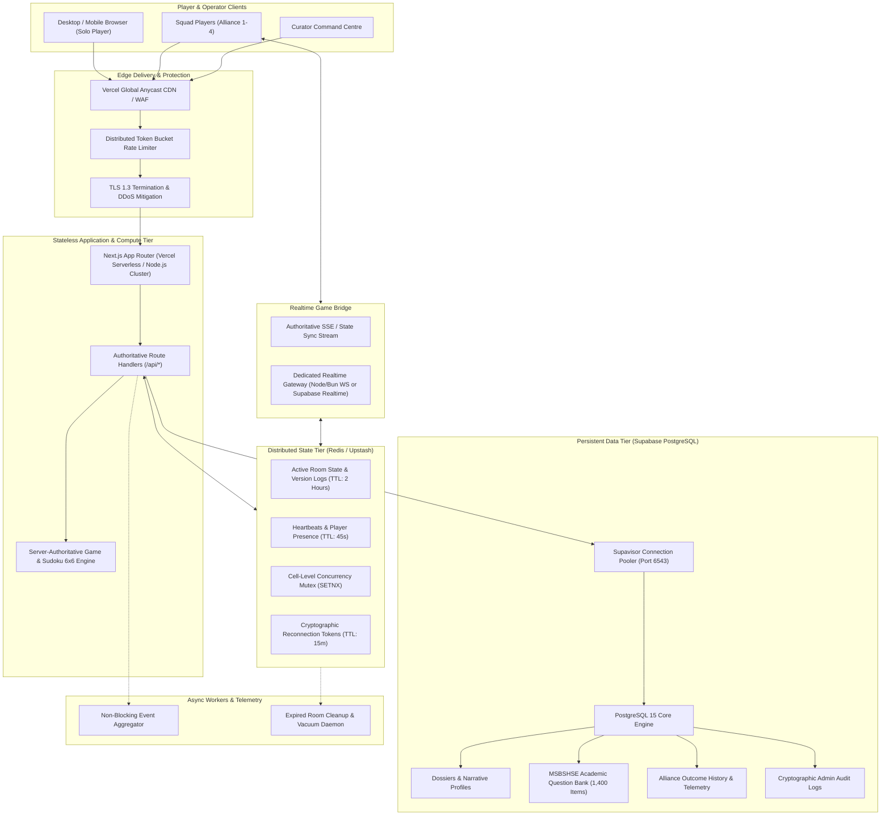

# THE UNWRITTEN — SCALABLE TARGET ARCHITECTURE

**Document:** `docs/infrastructure/scalable-architecture.md`  
**Status:** Approved Architecture Blueprint  
**Target Workload:** Up to 10,000 Concurrent Active Players (CCU)  
**Core Principles:** Strict Separation of Concerns, Server-Authoritative Integrity, Zero-Downtime Resilience

---

## 1. High-Level Architecture Diagram

---

## 2. Separation of Responsibilities

### Tier A: Web Application (Next.js 16 App Router)
- **Host:** Vercel Global Edge & Serverless Functions (or containerized Node.js cluster).
- **Responsibilities:**
  - Homepage & Cinematic Player Selection.
  - Public Player Profile, Session Token issuance, and Dossier Claim management.
  - Senior Mode narrative branches (Chapters 1–6) and Solo Storyboard campaign.
  - Junior Mode Academic Reasoning Studio (Class 11 & 12 curricula across 14 subjects).
  - KaTeX mathematical typesetting engine.
  - Interactive after-game monographs and pedagogical reflections.
  - Curator Command Centre UI (`/admin/*`).
- **Characteristics:** 100% stateless; horizontal scale-out with sub-second scale-up.

### Tier B: Real-Time Game Service & Authoritative Validation
- **Responsibilities:**
  - Authoritative room lifecycle: `lobby` → `in_progress` → `level_completed` / `retry_pending` → `game_over`.
  - Room code validation (regex: `^AL[0-9]{4}$`), host privileges, player readiness.
  - Authoritative game timers: Server timestamp deadlines, pause, resume, and penalty calculations.
  - **Shared 6×6 Sudoku Board:**
    - Guaranteed unique solution per puzzle ($2 \times 3$ subgrids, 3 difficulties).
    - Client-side solution redaction until puzzle completion.
    - Atomic move validation (prevents duplicate numbers in row, column, or $2 \times 3$ subgrid).
    - Shared hint pool (strictly 5 pedagogical hints per squad per round with cooldown).
    - Idempotent move processing using client transaction IDs (`txId`).
- **Isolation:** Every Alliance room is fully decoupled. A crash or timeout in room `AL1042` has zero impact on room `AL8921`.

### Tier C: Distributed Cache & Coordination (Redis / Upstash)
- **Responsibilities:**
  - **L2 Room Cache:** Ephemeral active room state stored under key `room:{code}`.
  - **Distributed Mutex:** Atomic lock (`lock:room:{code}:cell:{r}:{c}`) to serialize concurrent moves to the same grid coordinate.
  - **Heartbeats & Presence:** Key `presence:{code}:{playerId}` refreshed every 15s; expiry at 45s.
  - **Reconnection Vault:** Key `reconnect:{token}` mapping to `{code, playerId, expiresAt}`.
  - **Distributed Rate Limiting:** Sliding-window rate limit counters across all serverless instances.

### Tier D: Persistent Database (Supabase PostgreSQL via Supavisor)
- **Responsibilities:**
  - Permanent storage of completed campaign monographs, player dossier claim keys, question banks, historical outcomes, and administrative audit logs.
  - **Connection Pooling:** Connected through Supavisor port `6543` in transaction mode to prevent connection exhaustion.
  - **Write Deduplication:** Transient UI operations (e.g. cursor moves, hover states) are never written to PostgreSQL. Only final level outcomes, round milestones, and verified answers are committed.

### Tier E: Background Workers & Telemetry
- **Responsibilities:**
  - Asynchronous event aggregation (e.g. computing aggregate accuracy across 10,000 attempts).
  - Daily room state vacuuming (removing finished room keys older than 2 hours from Redis).
  - Periodic database backup verification and snapshot exports.

### Tier F: Edge Delivery & Protection
- **Responsibilities:**
  - Anycast CDN edge routing for static game assets (illustrated background scenes, character sprites, audio files).
  - DDoS protection and Web Application Firewall (WAF).
  - HTTP-level request body size enforcement (max 64 KB for JSON endpoints) to block payload exhaustion attacks.

---

## 3. Dedicated Game-Server vs. Serverless Deployment Strategy

### Current Hosting Assessment:
Vercel serverless executes functions within ephemeral environments with a default maximum execution timeout (10s on Hobby, 60s–300s on Pro/Enterprise). 
- For the existing HTTP polling and Server-Sent Events (SSE) architecture, Vercel Serverless paired with Upstash Redis handles **up to 5,000 concurrent active users** efficiently.
- When scaling beyond **5,000 concurrent users** or requiring ultra-low-latency persistent bidirectional WebSockets (<50ms tick rate):
  - **Recommendation:** Deploy a dedicated lightweight WebSocket gateway (Node.js / Bun cluster on Fly.io or Railway) that handles persistent TCP connections, while keeping the Next.js frontend and Supabase PostgreSQL on Vercel. Both tiers communicate seamlessly through the shared Redis state layer.

