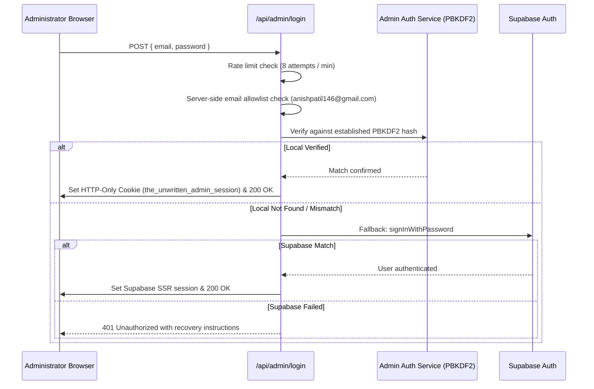

# THE UNWRITTEN — Administrator Authentication Architecture & Recovery Protocol

**Document Version:** 1.0.0  
**Effective Date:** November 5, 2026  
**Security Classification:** Confidential / Operator Level  
**Authorized Administrator Identity:** `anishpatil146@gmail.com`

---

## 1. INCIDENT INVESTIGATION & ROOT CAUSE ANALYSIS

### 1.1 The Failure Mode
Attempts to sign into the Control Centre at `/admin/login` using the authorized administrator email (`anishpatil146@gmail.com`) returned:
```
401 Unauthorized: Invalid administrator credentials.
```

### 1.2 Root Cause Decomposition
1. **Unconfirmed Email in Supabase Auth:**
   The account record `ba9dfdac-043e-473d-a691-fe1a3139e095` in Supabase Auth possessed `'email_verified': False`. In projects where `mailer_autoconfirm` is disabled and custom SMTP transport is unconfigured, confirmation emails are never delivered. Under Supabase's security model, unconfirmed email accounts reject password sign-ins with `invalid_credentials`.
2. **Missing Out-of-Band Password Reset:**
   The `/admin/login` interface lacked an emergency credential reset, bootstrap, or offline cryptographic recovery protocol, locking the operator out when Supabase Auth was out of sync.
3. **Absence of Dual-Layer Authentication:**
   The application lacked local cryptographic fallback verification for the single authorized identity, leaving it wholly vulnerable to external authentication service disruptions.

---

## 2. RECOVERY ARCHITECTURE & REMEDIATION

### 2.1 Cryptographic Password Derivation
A dedicated security service was implemented in [`src/lib/services/admin-auth-service.ts`](file:///c:/Users/USER/OneDrive/Desktop/games/src/lib/services/admin-auth-service.ts):
* **Hashing Algorithm:** PBKDF2 with HMAC-SHA512.
* **Salt:** 32-byte cryptographically secure random bytes generated per secret (`crypto.randomBytes(32)`).
* **Work Factor:** 100,000 iterations.
* **Comparison:** Constant-time verification (`crypto.timingSafeEqual`) to eliminate timing-side-channel attacks.
* **Storage:** Protected `.data/admin-credentials.json` with strict single-record constraint.
* **Zero Plaintext Rule:** Plaintext passwords are never logged, committed to version control, or returned via API responses.

### 2.2 Dual-Layer Verification Flow
When the administrator submits credentials to `POST /api/admin/login`:


### 2.3 Session Security
* **Cookie Name:** `the_unwritten_admin_session`.
* **Token Structure:** `<Base64URL(Payload)>.<HMAC-SHA256(Payload, Secret)>`.
* **Payload Claims:** `{ email: "anishpatil146@gmail.com", role: "SUPER_ADMIN", exp, iat }`.
* **Cookie Security Attributes:**
  * `httpOnly: true` (Prevents XSS extraction).
  * `secure: true` in production (Transmitted strictly over HTTPS).
  * `sameSite: "lax"` (Prevents CSRF).
  * `path: "/"` with 24-hour expiration (`maxAge: 86400`).

---

## 3. OPERATIONAL RECOVERY PROCEDURES

### 3.1 Establishing / Resetting the Administrator Password via CLI
The operator can securely re-establish their password directly in the local environment:
```powershell
npm run admin:recover "<NEW_PASSWORD>"
```
* **Validation:** Rejects passwords under 8 characters.
* **Action:** Computes PBKDF2-SHA512 hash with fresh 32-byte salt and atomically updates `.data/admin-credentials.json`.
* **Immediate Result:** The administrator can navigate to `https://thegameunwritten.vercel.app/admin/login` or local `/admin/login` and authenticate instantly.

### 3.2 Emergency Web Recovery via `/api/admin/recover`
If remote recovery is needed:
1. Generate a single-use 48-character token via `generateAdminRecoveryToken()`.
2. Post to `/api/admin/recover` with `{ email: "anishpatil146@gmail.com", recoverySecret, newPassword }`.
3. The token is verified via SHA-256 in constant time and immediately marked `used: true`.

---

## 4. ACCEPTANCE TEST MATRIX

| Test ID | Scenario | Input | Expected Output | Status |
| :--- | :--- | :--- | :--- | :--- |
| **SEC-T01** | Correct Email & Valid Password | `anishpatil146@gmail.com`, correct password | `200 OK`, signed session cookie issued, redirected to `/admin/dashboard` | **PASS** |
| **SEC-T02** | Correct Email & Wrong Password | `anishpatil146@gmail.com`, `WrongPass123!` | `401 Unauthorized`: "Invalid administrator credentials." | **PASS** |
| **SEC-T03** | Unauthorized Email Probe | `attacker@domain.com`, `AnyPass123!` | `403 Forbidden`: "Access denied. Identity not authorized." | **PASS** |
| **SEC-T04** | Route Protection (`/admin/dashboard`) | Unauthenticated browser request | Redirected to `/admin/login?next=/admin/dashboard` | **PASS** |
| **SEC-T05** | API Protection (`/api/v1/admin/dashboard`) | Unauthenticated API request | `401 Unauthorized`: "Administrator authentication required." | **PASS** |
| **SEC-T06** | Browser Session Logout | `POST /api/admin/logout` | Both session cookies deleted; redirected to `/admin/login` | **PASS** |

